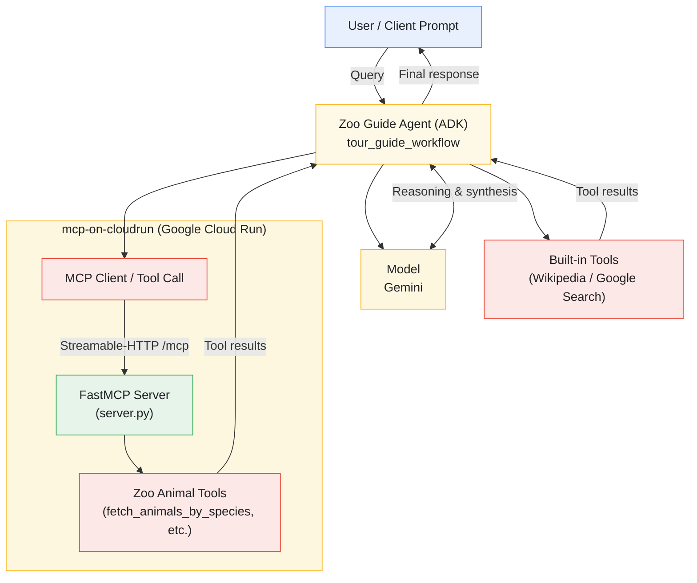

# 🤖 Zoo Guide Agent 🐻🐘🦁🐧

https://github.com/user-attachments/assets/14855b8e-f39b-497c-90bc-f3ac24d85031

> 🎥 Watch **Zoo Guide Agent** in action! 🐾

> [!CAUTION]
> The Cloud Run deployment is currently unavailable because the Google Cloud project has exhausted its available credits. The project was previously deployed and tested successfully on Google Cloud Run.

---

## Table of Contents

- [Introduction](#introduction)
- [Architecture Diagram](#architecture-diagram)
- [Project Structure](#project-structure)
- [Features](#features)
- [Tech Stack](#tech-stack)
- [Application Workflow](#application-workflow)
- [Screenshots](#screenshots)
- [Generative AI Capabilities & Integration](#generative-ai-capabilities--integration)
- [AI-Assisted Development](#ai-assisted-development)
- [Google Skills Challenge Lab Reference](#google-skills-challenge-lab-reference)
- [Future Enhancements](#future-enhancements)
- [Resources](#resources)
- [Disclaimer](#disclaimer)
- [Contributing](#contributing)
- [License](#license)
- [Author](#author)

---

## Introduction

**Zoo Guide Agent** is a tool-aware AI agent application developed as part of hands-on Google Cloud and generative AI learning experiences. It pairs a conversational zoo guide agent (`zoo_guide_agent`) with a Model Context Protocol (MCP) server component (`mcp-on-cloudrun`), powered by **Google Agent Development Kit (ADK)** and **Gemini models**, with containerized deployment on **Google Cloud Run**.

The project explores how to build interactive AI assistants capable of invoking external MCP tools and cloud services to answer zoo-related and general discovery queries (such as locating animals like penguins or exploring exhibit details) with structured, reliable responses.

The repository organizes the agent implementation, MCP server/client modules, containerization configuration, and dependency specifications into a clean, reproducible workspace ready for local testing and serverless cloud deployment.

The project demonstrates practical concepts in agent orchestration, Model Context Protocol (MCP) tool integration, prompt design, Python dependency management with `uv` and `pip`, and containerized Cloud Run deployment.

This repository documents my implementation and learning with Google Cloud Generative AI, ADK, MCP servers, and Cloud Run workflows, including project structure, supporting modules, and learning resources.

---

## Architecture Diagram

The following diagram illustrates the architecture of **Zoo Guide Agent**, connecting the agent workflow with MCP tools and Google Cloud services:



> [!NOTE]
> This diagram provides a high-level overview of the agent reasoning loop, MCP tool execution, and Google Cloud Run hosting architecture.

### Architecture Overview

1. **User / Client Prompt**
   - Sends natural language zoo guide questions and prompts (such as locating animals or exhibit details) to the agent workflow.

2. **Zoo Guide Agent (`tour_guide_workflow`)**
   - Orchestrates multi-step reasoning, sub-agent routing (`greeter`, `comprehensive_researcher`, `response_formatter`), and tool selection using `agent.py` and Gemini models.

3. **MCP Server & Tool Integration (`mcp-on-cloudrun`)**
   - Exposes zoo animal tools via Model Context Protocol (`server.py` and `local_mcp_call.py`) alongside built-in tools (`wikipedia`, `google_search`) for local testing and remote execution.

4. **Google Cloud Run & Gemini**
   - Hosts containerized services (`Dockerfile`) on Google Cloud Run (`europe-west4`) while Gemini provides model reasoning and response synthesis from tool outputs.
  
---

## Project Structure

The repository organizes the workspace directory, MCP server module, ADK agent package, and project governance files into a clean layout.

```text
zoo-guide-agent/                                   # Repository root directory
├── zoo_guide_agent/                               # Workspace project folder
│   ├── mcp-on-cloudrun/                           # MCP server, local client script, and container setup
│   │   ├── Dockerfile                             # Container build configuration for Cloud Run
│   │   ├── local_mcp_call.py                      # Local test/invocation client for MCP tool calls
│   │   ├── pyproject.toml                         # Project metadata and `uv` / Python dependencies
│   │   ├── server.py                              # FastMCP server implementation and zoo animal tools
│   │   └── uv.lock                                # Locked dependency versions for reproducible builds
│   │
│   ├── zoo_guide_agent/                           # Core Zoo Guide ADK Agent package
│   │   ├── __init__.py                            # Package initialization module
│   │   ├── agent.py                               # Multi-agent workflow, instructions, and tool wiring
│   │   └── requirements.txt                       # Pip dependency list for the ADK agent environment
│   │
│   └── README-cloudshell.txt                      # Default Google Cloud Shell environment reference file
│
├── .gitignore                                     # Excludes secrets, caches, virtual envs, and OS files
├── CODE_OF_CONDUCT.md                             # Community conduct guidelines
├── CONTRIBUTING.md                                # Contribution workflows and guidelines
├── LICENSE                                        # Open-source license terms (Apache-2.0)
├── README.md                                      # Project documentation
└── SECURITY.md                                    # Security vulnerability reporting policy
```

> [!NOTE]
> This tree mirrors the exact repository structure on GitHub. Refer to `zoo_guide_agent/mcp-on-cloudrun/` and `zoo_guide_agent/zoo_guide_agent/` for component implementations.

### Key Components

- **`zoo_guide_agent/mcp-on-cloudrun/`** — Contains the FastMCP server (`server.py`), local MCP test script (`local_mcp_call.py`), `Dockerfile`, `pyproject.toml`, and `uv.lock`.
- **`zoo_guide_agent/zoo_guide_agent/`** — Contains the ADK sequential agent workflow (`agent.py`), package initializer (`__init__.py`), and `requirements.txt`.
- **`README-cloudshell.txt`** — Default Cloud Shell workspace readme included from the lab environment.
- **`.gitignore`** — Excludes `.env` files, credentials, virtual environments (`.venv/`), and Python caches (`__pycache__/`) from version control.
- **`CONTRIBUTING.md, CODE_OF_CONDUCT.md, and SECURITY.md`** — Outline contribution standards, community conduct, and security-reporting guidelines.

---

## Features

- **Conversational Zoo Guide Agent:** Answers zoo and animal discovery queries with structured, helpful context.
- **Model Context Protocol (MCP) Integration:** Connects agent workflows with MCP tools via `server.py` and `local_mcp_call.py`.
- **Local & Cloud Run Execution Support:** Supports testing locally while packaging cleanly for Google Cloud Run with Docker.
- **Reproducible Dependency Management:** Includes `pyproject.toml`, `uv.lock`, and `requirements.txt` for consistent environment setup.
- **Clean Secret & Cache Hygiene:** Configured with `.gitignore` to prevent accidental commits of `.env` files, credentials, or build/cache artifacts.
- **Modular Agent & Tool Separation:** Keeps `zoo_guide_agent` and `mcp-on-cloudrun` cleanly separated for easier maintenance and extension.

> [!NOTE]
> Actual runtime behavior depends on valid Google Cloud credentials, enabled APIs, allowed models, and proper environment configuration.

---

## Tech Stack

| Technology | Purpose |
|---|---|
| **Python** | Core programming language for agent logic and MCP server/client code |
| **Google Agent Development Kit (ADK)** | Agent orchestration and tool-calling framework |
| **Model Context Protocol (MCP)** | Standardized tool interface between agents and external capabilities |
| **Gemini Models & Vertex AI** | Core LLM reasoning, instruction following, and response generation |
| **Google Cloud Run** | Serverless container hosting platform for cloud deployment |
| **`uv` & `pip`** | Python package and lockfile/environment dependency management |
| **Docker** | Containerization of application and MCP server components |
| **Git & GitHub** | Version control and source code hosting |

> [!NOTE]
> The table describes the technologies and patterns reflected in the project implementation.

---

## Application Workflow

**Zoo Guide Agent** is structured around clear environment setup, MCP tool orchestration, sequential agent execution, and response synthesis

### 1️⃣ Environment & Dependency Setup

- Configure required environment variables (such as Google Cloud project ID, region, or model settings) in a local `.env` file while keeping `.env` out of version control.
- Install dependencies using `uv sync` (in `zoo_guide_agent/mcp-on-cloudrun/`) or `pip install -r zoo_guide_agent/zoo_guide_agent/requirements.txt`.

### 2️⃣ MCP Server & Local Testing

- Run or verify MCP tool execution using `zoo_guide_agent/mcp-on-cloudrun/server.py` and `zoo_guide_agent/mcp-on-cloudrun/local_mcp_call.py`.
- Confirm tool schemas, responses, and error handling work as expected.

### 3️⃣ Agent Query & Tool Routing

- Send a prompt to the agent (for example, `"Where can I find penguins?"`) via `adk web` or Antigravity CLI.
- The sequential agent workflow (`tour_guide_workflow` with `greeter`, `comprehensive_researcher`, and `response_formatter`) and Gemini model evaluate the request and invoke MCP zoo tools (`fetch_animals_by_species`, `fetch_animal_details`) along with built-in tools (`wikipedia`, `google_search`) when needed.

### 4️⃣ Containerization & Cloud Run Deployment

- Build the container image using `zoo_guide_agent/mcp-on-cloudrun/Dockerfile`.
- Deploy services to Google Cloud Run (such as `coding-zoo-mcp-server` and `coding-zoo-tour-guide` in `europe-west4`) with required environment configuration and IAM permissions.

### 5️⃣ Response Synthesis

- Tool outputs are returned to the agent and Gemini model, then synthesized into a structured, conversational response for the user.

--- 

## Screenshots

This section showcases **Zoo Guide Agent** in action, including CLI/agent interactions, MCP server/client runs, and Google Cloud / Cloud Run views.

### Agent Development Kit (ADK) Web UI


### Google Cloud Console Dashboard


### Cloud Shell Terminal


### ADK Agent Workflow Graph


### FastMCP 2.0 Server


### Antigravity CLI & MCP Tool Execution


### Project Source Code


### ADK Web UI — Agent Conversations, Traces & Events

#### Bears Query


#### Elephants Query


#### Tigers Query


### Google Cloud Run Service & Logs


---

## Generative AI Capabilities & Integration

### ADK Agent Orchestration

- Coordinates multi-step prompt evaluation, instruction following, and tool invocation within `zoo_guide_agent`.

### Model Context Protocol (MCP) Tools

- Exposes structured tools via `mcp-on-cloudrun` so the agent can interact with external capabilities cleanly.

### Gemini Model Reasoning

- Uses Gemini models to interpret user intent, synthesize tool results, and generate accurate, conversational responses.

---

## AI-Assisted Development

AI tools can support the development and exploration of modern generative AI applications by helping explain unfamiliar code, investigate implementation issues, understand agent architectures, and improve technical documentation.

During the development and learning process for **Zoo Guide Agent**, AI assistance was used to support activities such as:

- Exploring Google ADK agent structure, prompts, and MCP tool-calling workflows.
- Troubleshooting environment, model selection, and Cloud Run deployment details.
- Structuring repository documentation, `.gitignore rules`, and contribution guides.

AI-generated suggestions and code should be reviewed critically, verified against the actual implementation, and tested before being adopted.

---

## Google Skills Challenge Lab Reference

This project was developed alongside hands-on Google Cloud learning lab modules.

### Challenge Lab

**Build a Smart Cloud Application with Vibe Coding and MCP**

[Open the Google Skills lab](https://www.skills.google/paths/1282/course_templates/1459/labs/647519)

### Learning Context

The repository serves as a personal source-code project associated with this learning experience.

It provides a place to explore and document:
- Building AI agents with Google ADK and Gemini models.
- Integrating Model Context Protocol (MCP) tools (`mcp-on-cloudrun`).
- Managing Python dependencies with `uv` and `requirements.txt`.
- Containerizing and deploying agent/MCP services on Google Cloud Run.

For official learning objectives, instructions, and environment setup requirements, refer to the Google Skills lab link provided above.

---

## Future Enhancements

The following ideas could be considered for future versions of **Zoo Guide Agent**:

- **Rich Zoo Data & Exhibit Search:** Expand MCP tools with structured zoo map, animal habitat, feeding schedule, and exhibit lookup capabilities.
- **Automated Unit & Integration Tests:** Add `pytest` suites covering agent routing, MCP tool responses, and error edge cases.
- **Enhanced Observability & Logging:** Add structured logging and tracing across `zoo_guide_agent` and `mcp-on-cloudrun`.
- **Interactive Client Interface:** Build a dedicated web or mobile chat client on top of the Cloud Run backend.

> [!IMPORTANT]
> These are potential improvements, not claims that the features are already fully implemented.

---

## Resources

[](https://modelcontextprotocol.io/)
[](https://adk.dev/)
[](https://cloud.google.com/docs)
[](https://cloud.google.com/run/docs)
[](https://cloud.google.com/vertex-ai/docs)
[](https://ai.google.dev/gemini-api/docs)
[](https://docs.astral.sh/uv/)
[](https://docs.docker.com/)
[](https://docs.python.org/3/)
[](https://git-scm.com/doc)
[](https://docs.github.com/)

---

## Disclaimer

**Zoo Guide Agent** is a learning and demonstration project associated with Google Cloud training.

The project utilizes third-party technologies and services, including Google Cloud Run, Vertex AI, Gemini, Model Context Protocol (MCP), and Python packages. The availability, functionality, pricing, and policies of external cloud services are subject to their respective providers' terms.

Access to Google Skills lab environments and temporary GCP projects expires after completion or quota exhaustion. A completed lab does not imply permanent public availability of the deployed backend service.

This repository is intended for educational and demonstration purposes. Do not commit API keys, access tokens, service-account credentials, `.env` files, or private configuration files to source control.

---

## Contributing

Contributions are welcome! If you would like to improve **Zoo Guide Agent**, fix a bug, add tests, or improve the documentation, please review the following guidelines:

- [Contributing Guide](./CONTRIBUTING.md)
- [Code of Conduct](./CODE_OF_CONDUCT.md)
- [Security Policy](./SECURITY.md)

Please ensure that contributions are focused, documented, and tested where appropriate. Never include secrets or private configuration in issues, commits, or Pull Requests.

---

## License

This project is licensed under the **Apache License 2.0**.

See the [LICENSE](./LICENSE) file for details.

---

## Author

[**Sahil Sharma**](https://github.com/sahil-me)

Thank you for exploring **Zoo Guide Agent**! If you find the project useful, consider giving the repository a ⭐ to show your support.

